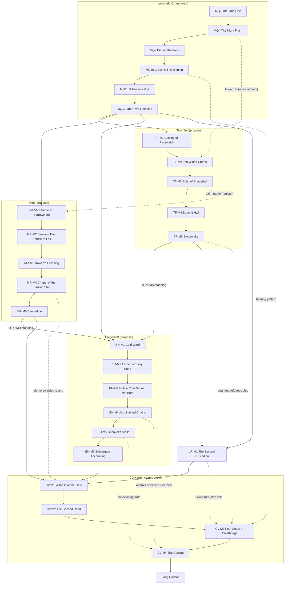

# Caelmor Narrative Architecture — Arcs, Milestone Quests, and Dependencies

**Status:** Proposal package for Creative Director milestone review (2026-11-02). Part of the package indexed in `Caelmor_Narrative_Architecture.md`. This file covers **deliverable 3** (major regional and cross-regional arcs through the envisioned endgame) and **deliverable 4** (milestone quests and the dependency framework). Lowmark v1 is complete and is treated as fixed foundation. Everything beyond Lowmark is a **high-level proposal**, not a production or release commitment. Status labels are defined in `Caelmor_Narrative_Architecture_Factions_and_World_Truth.md`; FT-nn ids refer to the foundational truths listed there and decided in `Caelmor_Narrative_Architecture_Review_and_Authoring_Sequence.md` §5.

Milestone codes below (`TF-M1`, `MR-M2`, `CV-M1` and so on) are planning labels only. The Schema & Content Engineer owns real ids. Lowmark keeps its existing bible codes.

---

## 1. The journey at a glance

| Layer | What it is | Release status | Player role |
|---|---|---|---|
| **0. Arrival** | Character creation; an ordinary wanderer on the Brookhollow road [CANON Phase 1.1 §6; v1 D-3]. | v1 | Nobody. |
| **1. Lowmark: *The River Remains*** | One complete main arc, 18 side quests, 10 micro-events. | **v1, authored** | Trusted hand of the Vale (`LM_CIVIC_STANDING`). |
| **2. Regional arcs** | Thornfell, the Mire, Emberholt. Each has a local present crisis, a local resolution, one hidden cost of the war, and one tool for the peace. | Proposal; Thornfell is the Phase 1.3 v1.5 direction, Mire and Emberholt unscheduled | Trusted in that region. |
| **3. Faction and civilian storylines** | Optional series that cross regions through ordinary work, records, and care: the unreturned register, the Watchers' book, horn and silence, guild ledgers, river intelligence, the unburnt. | Proposal | A carrier others rely on. |
| **4. Lowmark return: *The Fourteenth Lot*** | Lowmark's own hidden stop, discoverable only once another region holds the second custodian. | Proposal | The outsider Lowmark now trusts with its shame. |
| **5. Convergence: *The Peace Nobody Made*** | The four stops are assembled; the Second Road is halted; the four seats meet at Crestbridge; the Remnant's Perfect Flame is broken beneath Emberholt. | Proposal; requires all four regions | The one person each region will accept evidence from. |
| **6. Long Horizon** | Mastery-era stewardship of the new peace and optional deep-works exploration. The Forgotten God is never met. | Proposal | A steward among stewards. |

### 1.1 The central question

> **Thirty years after a war nobody ended, can four regions make the peace they never made, before the same pressures start the next war?**

Every regional arc answers a smaller, local version of that question first: a crossing, a closure, a name, a fire. The player's growth (Wonder → Competence → Attachment → Agency → Mastery, Phase 1.1 §6) is the growth from fixing one crossing to being the person all four regions will let carry the truth.

### 1.2 The four tools of the peace

Each region's arc ends by giving the player a civic practice the convergence needs. These are narrative competencies and standing, not powers or items.

| Region | Hidden cost of the war (its stop) | Tool for the peace | Where it is earned |
|---|---|---|---|
| Lowmark | It fed every side, and its crews stopped after the Fourteenth Lot (FT-02a). | **Many hands:** shared tending with no single owner (the v1 Braid plan). | Lowmark MQ10–12 (the tool, done in v1); LR-M1 (the stop, required before the convergence) |
| Thornfell | Its own horns killed its own, and its sealing stranded refugees (FT-02b). | **An honest closure:** an account of who a decision left behind, and deciding without a ruler. | TF-M5 |
| The Mire | Its Memorywardens broke themselves grounding the battlefield and made the General (FT-02c). | **Testimony that holds:** the two-custodian discipline, and refusing to let a manifestation speak for the dead. | MR-M5 |
| Emberholt | Its war ended in the Glassed Hollow, hidden as a forge collapse (FT-02d). | **Accountable power:** a civic account that separates useful fire from hidden harm. | EH-M6 |

### 1.3 Arc design rules

1. **Local first.** Every arc opens with a present, ordinary pressure (food, passage, care, heat) and resolves it locally. The war's hidden cost is discovered while solving it, never as the reason the arc exists.
2. **Stand alone.** Each regional arc must be completable and understandable by a player who did only the required Lowmark main arc and skipped every optional callback (Part 5 continuation principle).
3. **One owner per revelation.** Each major truth has exactly one owning arc. Other arcs may plant evidence for it but cannot reveal it first (see the revelation ledger).
4. **Antagonists are local.** House Marrick, the Thornfell splinter, the Mire's own unresolved care disputes, and Emberholt's hidden order each have their own motive. Only the convergence connects them, and only through the shared structural wound and the Remnant's bounded exploitation.
5. **Grounded scale.** The largest stakes in the game are a second war and a district-scale fire disaster. No world-ending threat, no god, no army of the dead (Phase 1.1 §3; Tenet 17).
6. **Three states only.** Every quest is Inactive, Active, or Completed. Nothing fails or is abandoned (Creative Director rule; see §7).
7. **Magic stays rare.** No milestone requires a player spellcasting system. If a future practice system is approved, milestones may add optional expressions of it; none depends on it.

---

## 2. Layer 1 — Lowmark: *The River Remains* (v1, complete)

Authority: `Caelmor_Lowmark_v1_Narrative_Production_Bible.md` and the act packages. Nothing here changes that content.

**Long-term role.** Lowmark teaches the player how Caelmor tells truth: records, places, testimony, and repair, never a ghost. It plants a small number of seeds that later arcs may pay off, all of which already exist in v1 content and all of which are complete locally.

| v1 anchor | Already authored as | Long-form use (optional, never required to understand v1) |
|---|---|---|
| MQ1 *The True Line* | Marker reading; the first strange moment | The marker-reading skill grows into the convergence's evidence vocabulary. |
| MQ4 *The Night Flush* | `NF_bill_of_lading` to an outside buyer, name a placeholder | Recommended payoff: the buyer is a Thornfell store-house serving an unsanctioned Blood-Oath reserve (FT-03). Opens an optional route into TF-M2. |
| MQ4 / MQ9 / MQ11 | The Fourteenth Lot; missing convoy stone; flow-table scar | The Lowmark return arc identifies the office behind the order and Lowmark's stop (FT-02a). |
| MQ9 *Behind the Falls* | Oriel: the Riverwardens withdrew because rulers asked for floods on command | Recontextualized in the convergence as part of the Concord's failure (H08). |
| MQ10 *The Crest Hall Reckoning* | The evidence-chip hearing | The convergence's four-seat hearing reuses the same play pattern at continental scale (CV-M3). |
| MQ12 *The River Remains* | `LM_CIVIC_STANDING`; the player's mark on the Whisperflow stone | The first of four regional standings the convergence requires. |
| Side quest *What the Flood Carried* | A sealed tin case, removable cross-region callback | Can carry one Thornfell or Mire record into the civilian storylines. |
| Side quest *A Verse Kept Back* | A missing verse in a thaw song | Compatible with a crew refusal song (FT-02a), never required. |
| Canon anchors | Aldric's ledgers older than the war; Corvin refuses Emberholt priority contracts; Lessa's "Mire-border foreshadowing"; Maelin's refused stretches | Aldric's ledgers become a convergence custodian; Corvin's caution feeds the Emberholt contract callback; Lessa can speak of the Mire border without kin or travel claims. |

**Deliberately unexplained in Lowmark forever** [PROPOSAL]: the Silent Bell of Greyharrow, Tovin's lagging reflections, the Uphill Canal's full mechanism, the Twice-Burned Tree's dream. Caelmor needs places that are strange without being clues.

---

## 3. Layer 2 — Regional arcs

Each arc lists: entry, premise, what the player learns and misreads, milestone quests, recurring cast, side-story pools, and exit standing. Each milestone lists narrative purpose, stakes, revelation, gameplay identity, consequences (outcome flags, never failure), and relationships.

### 3.1 Thornfell Marches — *The Wall That Was Kept* [PROPOSAL]

**Entry.** Requires Lowmark MQ12 (the only hard prerequisite; it is also the natural point at which the player has standing to be sent with a caravan). Optional alternate hook: following the buyer named on `NF_bill_of_lading` to Passwatch.

**Premise.** Winter is coming early to the high passes. A Blood-Oath splinter is hoarding stores and quietly rebuilding a forbidden war-horn from Echohewn plates as a deterrent against Emberholt. The Assembly does not know. A closure decision at Passwatch is about to strand a highstead again, and the cairn-keepers are fighting over a name.

**Player discovery.** The player arrives believing what Lowmark believes about Thornfell: stubborn, proud, the shield of the war. They will misread the hoarding as Emberholt pressure, the horn-echo as ghosts, and the Summit as a guardian. They learn that Thornfell's proudest story, the wall it kept, rests on horns that killed its own people and a sealing that left refugees outside.

**Gameplay identity.** Vertical traversal on agility triggers, ropes, and bridges; weather windows; **sound as a readable system** (horn codes, echo timing, null-points) as the Thornfell counterpart to Lowmark's marker reading; bridge and shelter repair (Woodcutting, Smithing); escort through passes; readable ridge combat.

| Milestone | Narrative purpose | Stakes | Revelation | Gameplay identity | Consequences (flags) | Relationships |
|---|---|---|---|---|---|---|
| **TF-M1 *The Closing of Passwatch*** (entry) | Teach Thornfell's obligations: who may close a pass, whose labor counts. | A highstead's winter supply on the wrong side of a closure. | Closures save some and strand others; Thornfell keeps no record of the stranded. | Escort and repair in a closing weather window; first horn codes. | `TF_PASSWATCH_ROUTE` (who gets through first). | Ressa Highcrag, Hadrik Stonewake; optional Lowmark grain stencil (buyer thread). |
| **TF-M2 *The Iron Winter Stores*** (Act I turn) | Expose present rearmament without a villain from outside. | Hidden stores bought with stolen relief grain; an Assembly that does not know. | A Blood-Oath splinter is preparing for war on its own authority, and Lowmark's stolen relief grain fed it (FT-03). | Infiltration of a cliff store-house; inventory as evidence; a fight that stops at surrender. | `TF_STORES` (reported / seized / left as leverage). | Brynjar Korr must defend or disown it; Elira Hearthward; Lowmark callback C4 if held. |
| **TF-M3 *The Echo of Shatterfall*** | Separate weather, engineering, resonance, and myth. | Miners and a salvage crew caught by storm horn-echoes. | The horn that split the ridge was real; it killed Thornfell's own rear guard. Two honest records disagree: a cairn's last sighting and a later service entry. | Storm-timed traversal; enduring the Horn-Echo phenomenon (positioning against telegraphed charges); reading plates. | `TF_SHATTERFALL_ACCOUNT`. | Dorn Feldhorn, Maera Cairnwatch; cairn name dispute seeds the Mire register. |
| **TF-M4 *The Summit Hall*** | Show ancient power as passive and dangerous, and Thornfell's own misuse as the trigger. | The splinter tests the rebuilt horn in the Summit halls; the node responds. | The Summit "guardian" is a passive Stonebound response to disturbance; it has no message. The splinter's horn, not Emberholt, woke it (C11 canon boundary kept). | Ascent with Kaldren and Iven; pressure-pulse hazards; silencing the horn plates in the right order using null-points. | `TF_HORN` (silenced / broken / surrendered to the Assembly). | Kaldren Deepdelver ("waking them all at once would tear the mountain apart"); Iven Ridgeborne. |
| **TF-M5 *Stonewake*** (capstone) | Return every finding to the Assembly; decide readiness versus peace without a ruler. | Whether Thornfell answers Emberholt's drills by closing every pass, as in the final war year. | Thornfell's stop: the final-year sealing stranded refugees, some of whom reached the Mire (FT-02b). The player brings the closure record to the hall. | Assembly hearing with evidence chips, as in Lowmark MQ10; where people stand in the hall matters (Hadrik's canon trait). | `TF_ASSEMBLY_POSTURE` (watchful / open / sealed-with-terms). Sets `TF_STANDING`. | All Thornfell anchors; Thornfell's posture is read by the convergence. |

**Side-story pools.** The highstead labor and shelter duties; the lost banner of Thornfell [CANON myth]; cairn ethics; Oathkeeper's Step; the Silent Gorge null-point; repair credit owed to a Lowmark crossing (Part 4 braid 2); joint repair with Emberholt workers strained by restrictions (braid 9).

**Exit.** `TF_STANDING`. The player now holds the first piece of a stranded-refugee chain that the Mire can complete.

### 3.2 The Mire of Fallen Banners — *What the Earth Refuses to Forget* [PROPOSAL]

**Entry.** Requires Lowmark MQ12. No Thornfell requirement. Optional alternate hook: carrying a Thornfell cairn name (TF-M3) or a Lowmark half-name (*The Candle Rule* or *What the Flood Carried*) to Sorrowmere.

**Premise.** A route closure and a recovered name put survival beside dangerous earth-memory. Banners at the Field of Fallen Standards are rising in the mud. Two families claim one fostered person. Rowan will not cross to the Chapel. Something large is moving under Bannerline Ridge.

**Player discovery.** The player expects a haunted graveyard. They will misread manifestations as ghosts with messages, the General as a returned commander, and the Memorywardens as villains who corrupted the land. They learn that the Mire's ground stopped the war because a handful of people broke themselves to make it stop, and that what they left behind still repeats orders.

**Gameplay identity.** Route mastery on shifting ground (channel states that change with water and season, learned rather than marked); testimony matching between registers, objects, and living memory; care work (Cooking and healing support); banner retirement as a hands-on rite; fog, lantern lines, and night travel; heavy, slow, readable earth-memory combat.

| Milestone | Narrative purpose | Stakes | Revelation | Gameplay identity | Consequences (flags) | Relationships |
|---|---|---|---|---|---|---|
| **MR-M1 *The Name at Sorrowmere*** (entry) | Teach care and testimony as civic structure. | A living fostered person whose two families each want a final answer. | One person can carry several honest records (Part 4 braid 8 or 4). | Register search, interviews, and a walk to a care site through shifting channels. | `MR_NAME_RECORD` (amended / qualified). | Edris Hollowmere, Lysa Thornettle; optional Thornfell or Lowmark callback. |
| **MR-M2 *The Banners That Refuse to Fall*** | Separate Memorykeeper records from Memorywarden relics. | A banner field whose rising standards are drawing Banner Wraiths onto a work route. | Banner Wraiths are impressions, not souls; retiring a banner quiets a site; a Memorywarden shard reacts to grief. | Recovery and retirement rites under attack; route repair. | `MR_BANNERS` (retired / restored). | Calwen Reed-Binder, Mara Fenholt. |
| **MR-M3 *Rowan's Crossing*** | Earn the Chapel through restraint and preparation. | Rowan's trust, and the only safe approach. | Rowan's knowledge is exceptional and cannot be shortcut (CANON). | Preparation tasks and a guided night crossing learning channel states. | `MR_ROWAN_TRUST`. | Rowan Mirewake; Old Sennic Vale (memories as leads). |
| **MR-M4 *The Chapel of the Sinking Star*** (Act II turn) | Recover the Memorywardens' last record. | A submerged chapel whose lantern lines are failing. | The last Memorywardens grounded the battlefield to stop the fighting; the overload killed them and concentrated the command-imprint (FT-02c). The name "Sinking Star" stays unexplained. | Submerged-chapel exploration with breath and lantern management; the record beneath the altar. | `MR_WARDEN_RECORD`. | Rowan, Sennic; Chapel-Tenders. |
| **MR-M5 *Bannerline*** (capstone) | Face the General as consequence, not ghost. | The General's imprint is pushing out along Bannerline and drawing Hollowfoot packs. | The General cannot testify or be bargained with. Combat disperses it for a night; retiring the regiment's standards and completing an unfinished mourning circle quiets the ridge. | Multi-phase earth-memory encounter on a readable count (command pulses, formation lanes), then a community rite the player holds open. | `MR_BANNERLINE` (quieted / tended). Sets `MR_STANDING`. | Edris, Bran Hollowstep, Calwen, Mara, Thornfell Ridge Wardens if `TF_STANDING`. |

**The Sorrowback** is deliberately **not** a Mire-arc boss. It is drawn to violent conflict [CANON], so it stirs during the convergence when the regions mobilize (CV-M2). The Mire arc only shows its trail and Bran's warning.

**Side-story pools.** The Father Who Waits at the Ford; the Singing Trench; Rootrest pilgrims; Rootshadow smuggling of banner cloth; Glassed Hollow displaced arrivals (braid 12), held back until Emberholt is playable or kept as an unresolved name.

**Exit.** `MR_STANDING`. The player holds the Memorywarden record and the stranded-refugee chain's Mire end.

### 3.3 Emberholt Heights — *The Brightest Flame* [PROPOSAL]

**Entry.** Requires Lowmark MQ12 **and** either `TF_STANDING` or `MR_STANDING`. Emberholt's archives and civic manipulations need a player who has already learned that records and testimony can be wrong (§6.3 explains why this is the one regional gate beyond Lowmark).

**Premise.** A heat-allocation dispute in Cinderwall leaves a ward cold while the Ash Terraces rehearse a festival. Academies are testing children harder. Deepbrand has lost a crew near the old Hollow. A Volkhari seamstress is afraid of a new neighbour.

**Player discovery.** The player arrives expecting a villain city, because every other region told them so. They will first be wrong in the other direction: Emberholt's fire wardens, teachers, and guild workers are competent and sincere. Then they find the hidden face: curricula as conditioning, the Speaker's ambition, the Hollow's truth, and a captive.

**Gameplay identity.** Heat as terrain (heat zones, cooling routes, timing vents) as Emberholt's readable system; civic investigation in archives and ceremonies; forge mastery (Smithing apex commissions); deep descents in the Emberdeep Warrens; sealed-chamber puzzles; readable fire hazards and resonance constructs.

| Milestone | Narrative purpose | Stakes | Revelation | Gameplay identity | Consequences (flags) | Relationships |
|---|---|---|---|---|---|---|
| **EH-M1 *Cold Ward*** (entry) | Show embercraft as ordinary civic infrastructure and class pressure. | A ward without heat; a fire warden blamed for it. | Allocation follows influence; the warden is honest. No Remnant required. | Heat-network repair with a fire warden crew; Cinderwall streets. | `EH_COLD_WARD`. | Yorven Khelt, a [NEW] fire warden; the Cinder Rat glimpsed. |
| **EH-M2 *The Ember in Every Hand*** | Reveal curricula as conditioning without condemning teachers. | Children pushed past safe volatility in tests. | Exams double as compatibility assessments; some ceremonies are mass emotional tests (CANON). | Assisting a class; observing a volatility test; recovering assessment ledgers from Theryn Dalewright's school. | `EH_CURRICULUM` (exposed to guild / kept as evidence). | Theryn Dalewright, Selice Morra; Maeryn Vall (Volkhari, hidden). |
| **EH-M3 *The Hollow That Should Not Burn*** (Act I turn) | Establish the directed Glassed Hollow core through evidence. | A lost Deepbrand crew; a sealed site the Emberguard will not open. | Precursor abuse, an initiate Titan, Kaelith free, Thalan captive; "forge collapse" is false. The Hollow was meant to end the war (FT-02d). Requires a C03 ruling. | Descent past Emberguard seals; glassed-cavern traversal; Darven Mott's testimony; restricted records with provenance. | `EH_HOLLOW_TRUTH`. | Darven Mott, Marenya Silvertide (custodian, not a truth source), Seredh Embercarver. |
| **EH-M4 *Ash-Stained Chains*** | Find Thalan, and treat Volkhari as people, not plot keys. | Thalan's life; the exposure of every hidden Volkhari. | Thalan is alive and used for Perfect Flame research. | Emberdeep infiltration, heat-pressure traps, sigil reading; Volkhari allies decide how far they will go. | `EH_THALAN` (freed / aided-in-place; see Director decision D-E2). | Asera of the Three Breaths, Thennek Vorren, Dahrin Vosk; Kaelith seen, never rescued. |
| **EH-M5 *The Speaker's Smile*** | Expose the Speaker's double nature in public view. | The festival rehearsal is a mass conditioning event. | The Speaker knowingly serves Remnant aims for his own ambition; several councillors are dream-influenced (Review §2 contradiction 2). | Rally attendance, intercepted correspondence, Hearthveil sleep chambers. | `EH_SPEAKER` (challenged publicly / exposed to the Council). | Seralynd Hearthveil, Serix Arden, Vael Trossen, Kaevren Thalos. |
| **EH-M6 *Embergate Accounting*** (capstone) | Separate useful fire from hidden harm in a civic account. | Whether Emberholt blames the Volkhari, the guilds, or itself. | Emberholt's stop and the Remnant's existence enter the civic record through provenance-safe evidence; the Remnant retreats into the deep works rather than being destroyed. | A civic hearing with evidence chips; a defended archive under Deepbrand attack. | `EH_ACCOUNT`. Sets `EH_STANDING`. | Council, forgeguilds, Covenant, Volkhari witnesses. |

**Why Perfect Flame is not Emberholt's capstone.** The dossier proposes *Perfect Flame* as the regional capstone. This package moves its climax to the convergence (CV-M4) so that Emberholt's regional arc resolves locally (a civic account) and the Remnant's final attempt draws on the whole world's state. Emberholt players still see the plan; they do not yet stop it.

**Side-story pools.** Forge saboteurs; Ember-Fused Workers (non-lethal containment, CANON); the Boy of Living Flame myth; Glassmoth's dream tonics (Dreamer thread); the Flame That Would Not Die; joint repair with Thornfell (braid 9); a Lowmark priority-contract correction (Part 5 callback).

**Exit.** `EH_STANDING`. Emberholt holds the Hollow truth; the Remnant is exposed but not ended.

---

## 4. Layer 3 — Faction and civilian storylines (optional series)

These are RuneScape-style independent series (see the study) translated to Caelmor's evidence rules: they cross regions through records, work, and care, never through a conspiracy. None is a prerequisite for a main arc except where §6 says a single milestone may be used as one of several alternative evidence chips.

| Series | Regions | Spine | Grounded in | Payoff |
|---|---|---|---|---|
| **The Register of the Unreturned** | Lowmark → Thornfell → Mire → Emberholt | One person, several honest records: half-names, cairns, care entries, displacement lists. Three to five self-contained cases, each resolved where its family lives. | Part 5 Thread 2; Part 4 braids 4, 8, 12; "fosterage after a war separation". | Each case corrects a garden, cairn, or memorial. Completing cases adds evidence chips to CV-M3 (stranded refugees, displaced Hollow civilians). |
| **The Watchers' Book** | Lowmark | Ansel's new patrol book after MQ11; drift sites tended; Watchers train new hands. | v1 drift-site state model. | Post-v1 Lowmark mastery content; Watchers join the convergence's crossing defence. |
| **Horn and Silence** | Thornfell | Which notes must never be played again; Ressa and Dorn decide what to keep. | Ressa's forbidden calls, Dorn's altered echoes [CANON]. | Thornfell's horn codes become the convergence's alarm network. |
| **The Guild Ledgers** | Lowmark → Emberholt (→ Thornfell) | Salvage steel (*Honest Steel*) traced to pre-war forging fragments the Remnant covets. | Forgeguild tension [CANON]; v1 *Honest Steel*. | Forgeguild trust in EH-M6; Smithing master commissions. No exclusive Founder technique (C07). |
| **Fog and Riverglass** | Lowmark → Emberholt | Lowmark smugglers who unwillingly sell information to Remnant channels. | Shadeweavers [CANON]; v1 *Under the Lamb*. | Reveals Durell's bounded reach; an informant for CV-M2. |
| **Unburnt** | Emberholt | Protected Volkhari testimony; what Asera will teach and to whom. | Volkhari individuals [CANON]. | Asera's discipline is offered in CV-M4 only if the player kept faith with Volkhari choices. |
| **Dreamers** | Any | Personal stories in which a dream prompts an evidence check; one case exposes a Hearthveil-seeded vision. | Part 5 Thread 5 [CANON rules]. | Hearthveil exposure supports EH-M5 and CV-M3. |

**Self-contained stories must stay numerous** [Part 5 rule]. Each region's side slate should be at least half stories with no cross-region link.

---

## 5. Layers 4–6 — Lowmark return, convergence, Long Horizon

### 5.1 Lowmark return: *The Fourteenth Lot* [PROPOSAL]

**Unlock.** `LM_CIVIC_STANDING` and `TF_STANDING`. **Required before the convergence** (it owns FT-02a, which CV-M1 assembles), optional for all regional play. The second custodian for the order is a Thornfell engineering work log kept by the dwarven engineers who cut the Relief Cut [PROPOSAL; Kaldren may carry Echohewn stewardship but is not made the log's author].

| Milestone | Purpose | Revelation | Gameplay identity | Consequences |
|---|---|---|---|---|
| **LR-M1 *The Second Custodian*** | Pair the Bramblelock stones and Fenmere ledgers with the Thornfell log. | The flush order came from the wartime supply command under a Fenmere compact; after the convoy sank, the crews refused to run (FT-02a). Lowmark fed every side. | Ledger and log comparison; a dive at the convoy site now that the fen is quiet or sealed (reads `LM_FEN_ENDING`). | `LR_LOT_ACCOUNT` (spoken at Crest Hall / entrusted to the families / kept by the crews), and `LR_STANDING` for the convergence gate. |

This is short on purpose: a single strong milestone and two or three side stories (the crews' song, a family of the drowned, Aldric's choice about his ledgers).

### 5.2 Convergence: *The Peace Nobody Made* [PROPOSAL]

**Premise.** Signs of the Second Road appear everywhere at once: hoarding, closures, drills, refugees on the move, the Sorrowback rising. The player is the one person every region has seen act honestly. Someone has to carry four accounts to one table before the passes close.

| Milestone | Narrative purpose | Stakes | Revelation | Gameplay identity | Consequences | Prerequisites |
|---|---|---|---|---|---|---|
| **CV-M1 *Witness at the Gate*** | Discover the Crossing Concord and assemble the four stops. | Without the whole truth, each region will act on its own war story again. | The prewar Concord existed and failed (FT-01). The war ended in four separate stops; no peace was made (FT-02). | Cross-region evidence gathering: Fenmere ledgers, horn rosters, the Memorywarden record, the Hollow account. Uses the four tools. | `CV_FOUR_STOPS`. | `LR_STANDING` (implies `LM_CIVIC_STANDING` and `TF_STANDING`), `MR_STANDING`, `EH_STANDING`. |
| **CV-M2 *The Second Road*** | Hold the world together long enough to meet. | A pass incident between Thornfell and Emberholt could become a battle; refugees move; the Sorrowback rises. | Durell's bounded operations: forged inspection notices, seeded rumors, informants (FT-04). The Remnant did not make the fear; it is feeding it. | World events (Phase 1.3 future scope), grounded: defend a crossing, escort refugees, quiet a skirmish before it becomes a battle, and the **Sorrowback** as a readable, large earth-memory encounter in the Mire that recedes when the mobilization stops. Repeatable, never failing. | `CV_ROAD_HELD` (set when the player completes the event chain; world-event intensity reads regional postures). | CV-M1. |
| **CV-M3 *Four Seats at Crestbridge*** | Make the peace that was never made. | Delegates from four regions meet at Crest Hall; dream-influenced Emberholt delegates and one act of Deepbrand sabotage try to break it. | Each region hears its own hidden cost from another region's custodian. A new Concord is possible: witness at every crossing, no ruler, shared tending. | Finding and stopping one act of sabotage at Crest Hall (no siege; Lowmark MQ10 already owns that beat) and a four-region evidence-chip hearing. Chips come from every arc and optional series; any sufficient set works. | `CV_CONCORD_TERMS` (scope of witness and inspection). | CV-M2. |
| **CV-M4 *The Cooling*** (convergence climax) | Break Perfect Flame without spectacle. | The Remnant's final attempt beneath Emberholt during the festival: synchronized amplification through ember veins, Thalan's research, and a conditioned crowd. Left unchecked, it would be a second Glassed Hollow under the city (the quest itself cannot fail; it stays Active until completed). | Perfect Flame needs the crowd's conditioned emotion; citizens who know the truth (EH-M5, CV-M3) refuse it. Once the excavation stops, heat and pressure in the deep works settle and the stirring Fire Titan's chamber cools (FT-05; a physical, place-bound response, never a choice). | Deep descent through the deep works, applying what each region taught (Thornfell's sound reading, the Watchers' patience learned in the Mire, testimony that turns the crowd, Asera's discipline if offered, all carried by the player or by unnamed local hands, never by anchors given new travel); heat and pressure as terrain; an environmental survival and protection sequence around the Titan's chamber. **There is no Titan fight.** The Titan's fate is a Director decision (D-CV1). | `CV_COOLING` (Titan contained / Titan at rest). Unlocks the Long Horizon. | CV-M3. |

**What the convergence must never become** [PROPOSAL rule]: a battle of mages, a march of the dead, an awakened god, or the Remnant as the cause of everything the player saw earlier. The decisive acts are refusal, testimony, shared tending, and a careful descent.

### 5.3 Long Horizon [PROPOSAL]

Post-convergence, mastery-era content:

- **Keeping the Concord.** Recurring, non-failing civic work: witness duty at crossings, Braid tending, pass inspection, register cases. Each is a short repeatable structure in a region the player already knows. This is where faction systems from Phase 1.3 future scope could live, if approved, without a reputation grind.
- **The deep works.** Optional, high-mastery exploration of the Riverwarden inner oasis, the Echohewn depths, Memorywarden anchor circles, and the Stonebound works beneath Emberholt. Each reveals more about what the Mythic Age built to keep the world in balance. None reveals the Forgotten God.
- **Teachers' Roads** (after a C07 ruling). An optional history series that refines the four Founder tales without creating a chosen lineage.
- **Practice under the peace.** If player elemental practice is ever approved, the Concord's witness rules are the in-world framework for learning it: taught by many hands, inspected, bounded. This is a hook, not a commitment.

---

## 6. Dependency framework

### 6.1 Edge types

| Edge | Meaning | Rule |
|---|---|---|
| **Hard prerequisite** | Quest B cannot become Active until quest A is Completed. | Used only between milestones, never from a side quest to a milestone. Maximum two hard prerequisites per milestone except convergence entry. |
| **Standing gate** | A region standing flag (`LM_CIVIC_STANDING`, `TF_STANDING`, `MR_STANDING`, `EH_STANDING`) unlocks content. | Follows the existing `LM_*` region-flag precedent; flag schema belongs to the Schema & Content Engineer. |
| **Skill or access gate** | A skill threshold or a traversal route unlocks a step or an optional reward. | Main milestones use **recommendations** only, or a crew alternative. Hard skill gates are reserved for optional shortcuts, master commissions, and Long Horizon content. Exact levels belong to the Gameplay Designer. |
| **Evidence chip (alternative)** | A completed quest contributes one item to a later hearing. | Any sufficient set passes (Lowmark MQ10 pattern). No single optional quest is ever required. |
| **Optional callback** | An earlier outcome changes lines, a hook, or a chip in a later quest. | The later quest is complete without it. |
| **Shared character** | The same person appears in both. | Must respect the Part 4 character ledger: no new age, war service, travel, kinship, or record custody. |
| **Recurring evidence** | The same object, record, or place matters again. | The second appearance must come with an independent custodian. |
| **Thematic link** | Echo of a motif or lesson. | Never implies shared origin (Part 4 borrowing rule). |

### 6.2 Dependency graph

Solid arrows are hard prerequisites or standing gates. Dotted arrows are optional callbacks or alternative evidence chips. The graph shows milestones only.

### 6.3 Dependency table and rationale

| Unlock | Hard requirement | Why | Alternatives |
|---|---|---|---|
| Any future region | Lowmark MQ12 | Lowmark is the start and teaches the evidence rule; MQ12 gives standing to be sent onward. | None needed; Lowmark is the only release region and its main arc is required. |
| Emberholt (EH-M1) | Lowmark MQ12 and **one** of `TF_STANDING` / `MR_STANDING` | Emberholt's archives and civic manipulations need a player who has seen a proud record proved partial. Allows either release order for Thornfell and the Mire. | Either region. |
| Lowmark return (LR-M1) | `LM_CIVIC_STANDING`, `TF_STANDING` | The second custodian for the Fourteenth Lot order lives in Thornfell. | None. Optional for regional play; required before CV-M1 because it owns Lowmark's stop. |
| Convergence (CV-M1) | `LR_STANDING`, `MR_STANDING`, `EH_STANDING` (all four regions, with Lowmark's stop earned in LR-M1) | The premise is assembling four stops, each revealed first by its own owner. This is the single breadth gate in the game. | None; mitigated by allowing any regional order and by the Long Horizon not requiring optional series. |
| CV-M3 hearing | CV-M2 complete; any sufficient chip set | Same as Lowmark MQ10: more evidence gives better terms, never a failure. | Many chip sources. |

**Longest required chain** from character creation to the convergence climax: 12 (Lowmark) + 5 (Thornfell) + 5 (Mire) + 6 (Emberholt) + 1 (Lowmark return) + 4 (convergence) = **33 milestone quests**, in any regional order after Lowmark. No optional quest is ever required.

### 6.4 Skill and access connections (recommendations)

| Content | Connection | Type |
|---|---|---|
| TF-M1, TF-M3 bridge and shelter repair | Woodcutting and Smithing fittings | Recommended; a crew alternative exists. |
| Thornfell high routes after TF-M4 | Agility-trigger routes become available | Access reward. |
| MR-M3 Rowan's crossing | Learned channel states | Knowledge gate (Pillar A: routes, not stats). |
| EH-M3 deep descent | Heat-tolerant equipment from Emberholt makers | Recommended; a slower cooling route exists. |
| Regional master commissions | High skill plus regional standing | Hard gate (optional content), extending the v1 aspirational-commission pattern. |
| Long Horizon deep works | High mastery across several skills | Hard gate (optional content). |

---

## 7. Three-state compliance

The Creative Director's rule: quests are **Inactive, Active, or Completed**; they never permanently fail or become abandoned.

- **Choices are outcomes, not failures.** Every milestone above records its choice in an outcome flag. A worse outcome changes later lines and terms; it never closes content.
- **Hearings cannot be lost.** CV-M3, TF-M5, EH-M6, and Lowmark MQ10 accept any sufficient evidence set and always have a guaranteed path.
- **World events never fail.** CV-M2 events and Long Horizon duties are repeatable structures. A crossing that falls tonight can be held tomorrow.
- **No missable revelations.** Every revelation in the ledger has a guaranteed source inside its owning arc. Optional sources add depth only.
- **Contract mismatch to hand off.** `DESIGNS/Systems Design/Stage 27 — Quest Runtime Integration Definition.md` and `CODE/Systems/QuestRuntimeSystem.cs` still define a `Failed` state, and Stage 15.2 defines `Abandoned`. Narrative content will not use either. Removing or retiring them is a Systems Engineer change that needs the Director's sign-off (Review §2, contradiction 1).
